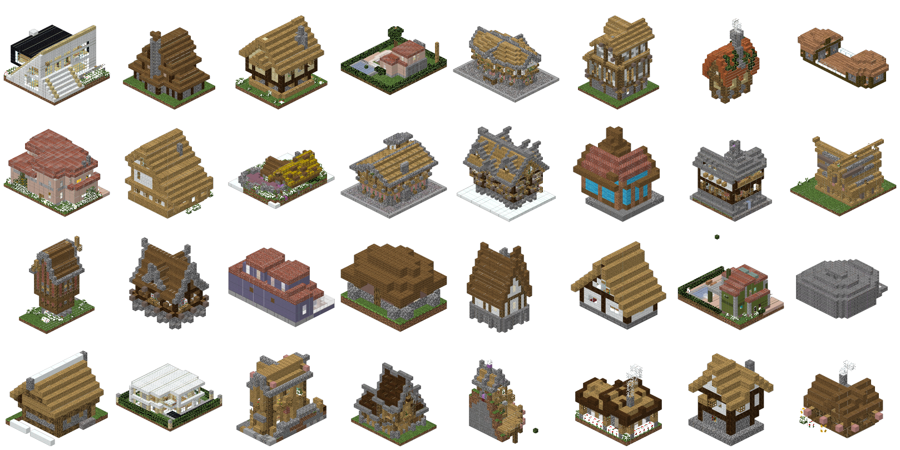
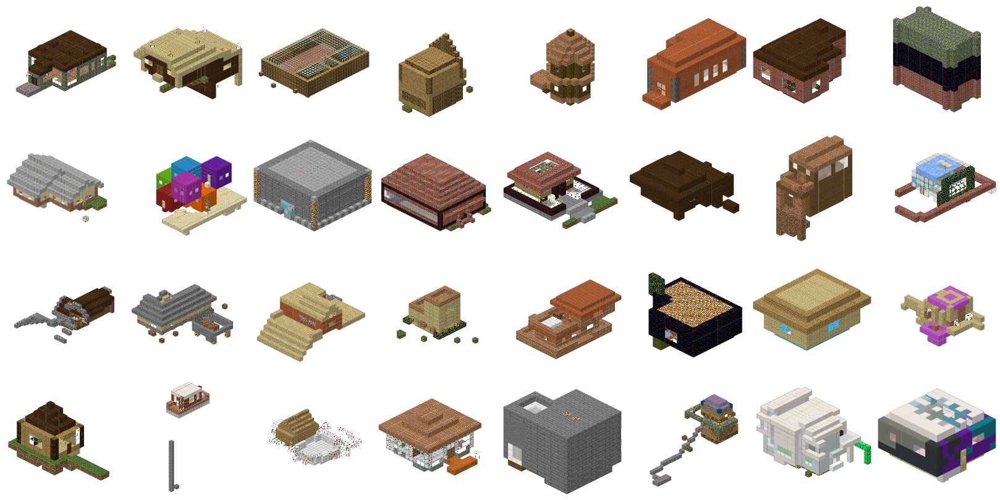
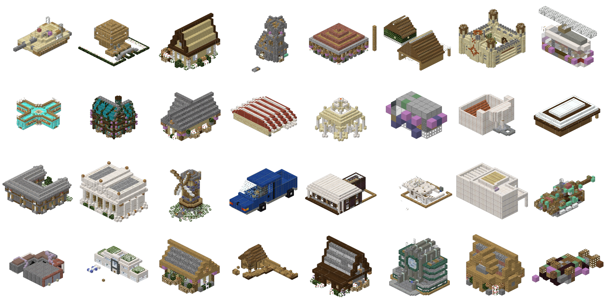
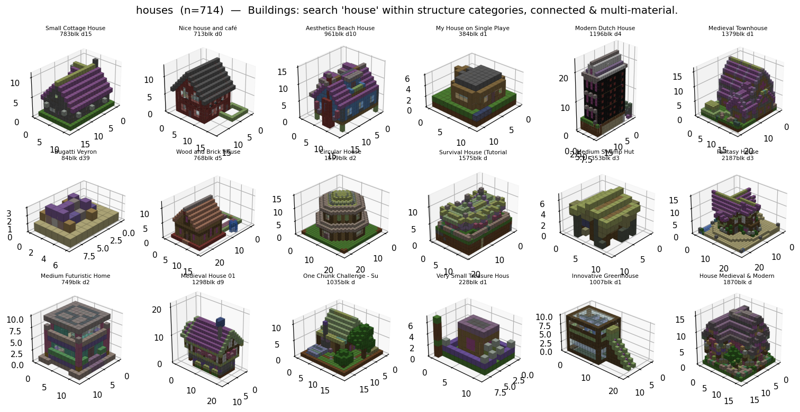

# Data: sources, curation, manifest, tiers, shards

This page follows a build from a raw source to the tokenised shard a training run
reads. The order is the order of the pipeline: sources, curation, the manifest,
deduplication and kinds, tiers, shards. The per-corpus inventory with licences and
sample sheets is `data_sources.md` at the repo root; the trainer side begins in
[Training pipeline](pipeline.md) §5. Commands below use the conda `python` on `PATH`
(torch and pandas); the project `.venv` has no pandas and cannot run the corpus layer.

```
raw sources ──► caches / crops ──► manifest ──► dedup + kinds ──► tiers ──► shards ──► blockgen.train
 (section 1)     (sections 1-2)    (section 3)   (section 4)      (sec. 5)  (sec. 6)
```

## 1. Sources

### 1.1 Minecraft schematic corpora

| Corpus | Path | Size | Loader | Labels |
|---|---|--:|---|---|
| GrabCraft | `data/minecraft/grabcraft/` | 6,560 builds | `blockgen/data/grabcraft_dataset.py` | 5 top-level / 113 sub categories, title, tags; exact `(id, data)` |
| 3D-Craft | `data/minecraft/3d_craft/` | 2,537 houses | `blockgen/utils/corpora.py::load_3dcraft` | one class, timestamped placement traces |
| text2mc `.h5` | `data/minecraft/text2mc/` | 11,092 builds | `corpora.load_text2mc` | free-text tags |
| text2mc `.schem` | `data/minecraft/text2mc/` | 28,235 raw files | `blockgen/utils/schem.py`, `corpora.load_text2mc_schem` | the same tags |
| tfrecord crawl | `data/minecraft/more/` | 36,290 NBT | `blockgen/data/tfrecord_dataset.py` | 15 map categories, views, diamonds |
| legacy schematics | `data/minecraft/raw/` | 12,366 files | `blockgen/data/build_cache.py` | none reliable (drifted) |
| templates | `data/minecraft/templates/` | 1,180 NBT files, 1,113 manifest rows | `blockgen/corpus/templates.py` (1.21.1 client jar) | piece name; internal only (Mojang assets) |

GrabCraft is the labelled workhorse: each build's texture field names an exact
`(legacy_id, data)` pair, so oak and spruce planks stay distinct. 3D-Craft stores each
house as a placement sequence (`placed.json`) beside the final `schematic.npy`; the
traces load but nothing trains on them. text2mc is modern flattened blocks remapped to
the legacy vocabulary by `blockgen/utils/block_remap.py`; the 28k raw `.schem` files the
authors never converted are decoded by `blockgen/utils/schem.py` (Sponge palette plus
varint `BlockData`). The tfrecord crawl and the legacy `data/raw` download are not in any
tier today.

### 1.2 World crops

`blockgen/data/worldcrop/` mines player-built structures out of whole world saves, because
schematics number in the tens of thousands while archived worlds number in the hundreds
of thousands. The source is the Minecraft Archive Project on archive.org: `remote.py`
opens a monthly zip over HTTP range requests and pulls one world archive at a time;
`anvil.py` reads McRegion, numeric Anvil and 1.13+ palette chunks without Amulet;
`detect.py` finds candidate components (superflat diff for flat worlds, STRONG and WEAK
block tiers plus vanilla structure masks for terrain worlds). Each crop keeps the full
bounding box (`ids`, `data`), the component `mask`, and provenance (archive item, member
path, thread title and permalink, bbox in world coordinates, route). Operator detail,
including RAR handling and the bulk driver `scripts/worldcrop_ingest.sh`, is on the
[World-crop corpus](worldcrop.md) page.

```bash
python -m blockgen.data.worldcrop.run --month 201407 --limit 400 --workers 12
python -m blockgen.data.worldcrop.analyze data/minecraft/worldcrop/201407
```

Outputs land under `data/minecraft/worldcrop/<month>/`: `worlds.jsonl`, `crops.jsonl`,
`crops/<world_id>_<k>.npz`, sheets. 88 months have a `crops.jsonl`; 47 of them are in the
manifest (section 3). Worlds carry their creators' copyright and no licence, so this
source is pretraining only and never redistributed (`research.md` §F).

**Cut builds.** Components are labelled per 24-chunk tile. `extract_crops` treats a
component touching a tile's x/z edge as cut, reloads a tile around its bounding box up to
`retile_depth` times, and records a component that still does not fit with `cut: true`
and `oversize: true` (`blockgen/data/worldcrop/detect.py`: `oversize = (max(dims) >
max_dim) or touches`, `cut = touches`). `run.py` saves no `.npz` for an oversize crop, so no
cut crop reaches the manifest. The `cut` and `oversize` columns exist
(`blockgen/corpus/manifest.py`, `COLUMNS`) but every row today has both `False`
(`manifest summary` prints `cut: 0`), and the `not cut` clause in the pretrain-clean and
anneal tiers removes nothing until the ingest keeps cut crops.

### 1.3 LEGO corpora

Fetched for the next medium and used today only by the interior-blindness replication
(`blockgen/eval/bench/lego.py`, split `lego_void_20`). Licences and fetch commands are in
`data/lego/README.md`.

| Corpus | Path | Size | Licence |
|---|---|--:|---|
| OMR (Open Model Repository) | `data/lego/omr/` | 1,819 models, 651,017 placements | CC BY 4.0 |
| StableText2Brick | `data/lego/stabletext2brick/` | ~42k structures | MIT |
| LDraw parts library | `data/lego/ldraw/` | 33,362 parts | CC BY 2.0 |
| LDCad Shadow Library | `data/lego/shadow/` | 4,251 connectivity files | CC BY-SA 4.0 |

Connectivity is not in base LDraw; the Shadow Library supplies stud and anti-stud mates
and covers 91.1% of OMR placements. `legogen/renderer/` (Blender 4.2 + ImportLDraw)
renders the sheets.

## 2. Curation

### 2.1 The terrain gate on world crops

The detector has no notion of shape, so edited terrain made of "built" ids (WorldPainter
plates, snow fields, superflat layers) comes through. `blockgen/data/worldcrop/gate.py`
scores every crop with `p_built` from a gradient-boosted tree
(`HistGradientBoostingClassifier`) over 295 cheap descriptors: block-id histogram,
material-family fractions, heightmap and column statistics, exposed-face ratio, enclosed
air, mirror symmetry, planarity, vertical profile. Positives are the GrabCraft, 3D-Craft
and `houses_48` builds masked to their blocks; negatives are natural terrain patches
(`gate_data.py`), synthetic surface skins, and 10k crops mined from the corpus by
composition. The acceptance test is a hand-labelled set of 192 random crops
(`data/minecraft/worldcrop/gate/eval_labels.jsonl`, labels built / terrain / fragment /
unsure) that is never trained on (results.md T54).

```bash
python -m blockgen.data.worldcrop.gate_data --month 201407 --worlds 30   # negatives
python -m blockgen.data.worldcrop.gate train                            # gate/model.pkl
python -m blockgen.data.worldcrop.gate score --workers 8                # <month>/gate_scores.jsonl
python -m blockgen.data.worldcrop.gate sheets --thr 0.5                 # pass / reject / border sheets
```

The gate removes terrain only. On the 192-crop set the final version rejects all 8
terrain crops and 3 of 106 builds, and no fragment. Fragments (partial builds, a wall
without its house, a half of a cut build) are about a third of the pass set by the hand
labels (65 of 192), which is why the manifest carries the gate features as a sidecar: a
fragment detector is a model over the table, not another pass over npz files.

### 2.2 The curated house caches

`blockgen/curation/houses.py` pools GrabCraft, 3D-Craft, text2mc `.h5` and text2mc
`.schem` into the shared legacy vocabulary, strips the ground slab from world-cut
corpora, applies eight per-corpus quality rules plus an enclosed-air "house-ness" gate
(at least 8 interior air voxels unreachable from the bbox boundary), and removes exact
duplicates while keeping material variants. `load_house_structures(max_dim)` is the
programmatic entry point.

```bash
python -m blockgen.curation.houses --max-dim 32   # data/minecraft/cache/houses_32.npz
python -m blockgen.curation.houses --max-dim 48   # houses_48.npz
```

| Cache | Pooled | Quality drops | Exact dups | Final | GrabCraft | 3D-Craft | text2mc `.h5` | text2mc `.schem` |
|---|--:|--:|--:|--:|--:|--:|--:|--:|
| `houses_32` | 3,493 | 826 | 6 | **2,661** | 1,360 | 1,267 | 34 | none (built before the source) |
| `houses_48` | 4,502 | 1,381 | 33 | **3,088** | 1,410 | 1,381 | 180 | 117 |

The top drop reason is no interior (675 at 32³): the gate rejects trees, vehicles and roof
fragments. GrabCraft is exempt from it because 17% of its ground-truth houses have open
interiors. The whole-corpus cache `all_32` (`blockgen/curation/corpus.py`, 4,712 builds)
is the third curated cache the manifest indexes.

| GrabCraft | 3D-Craft | text2mc |
|---|---|---|
|  |  |  |

/// caption
Per-corpus slices of `houses_32`, real-texture render (`blockgen/renderer/grid.py`).
///

### 2.3 The pinned split

`blockgen/eval/bench/splits.py` writes `data/minecraft/splits/houses_32.s0.70-15-15.v1.json`:
1,863 train, 399 val, 399 test, grouped by title so variants of one build share a side.
Every ranked arm on the board trained on the train side and is scored on the test side
(protocol `houses32-v1`, [Evaluation suite](benchmark.md)). The two split-backed tiers
in section 5 are this file read back.

### 2.4 Filters and curation at a glance

| Filter | Status | Where | Number |
|---|---|---|---|
| Learned terrain gate `p_built` (GBT, 295 features) | used | `blockgen/data/worldcrop/gate.py` | T54; `q` tag is 4 for every curated row (the gate trained on them) |
| Exact dedup (canonical hash, D4-minimal) | used | `blockgen/corpus/canon.py`, `dedup.py` | 216k rows folded (notes.md §46) |
| Near dedup (MinHash/LSH, Jaccard 0.8) | used | `canon.py`, `dedup.py` | 29.9% of the corpus is a duplicate |
| Recurrence filter `cluster_worlds >= 5` | used | `dedup.py`, `kinds.py` (`VILLAGE_WORLDS`) | vanilla village pieces |
| Kinds sidecar build / mixed / village / mineshaft | used | `blockgen/corpus/kinds.py` | build 77.2%, village 12.6%, mineshaft 9.2%, mixed 1.1% (927,427 rows) |
| `cut` / `oversize` / `route` flags | implemented, inert | `blockgen/corpus/manifest.py` (`COLUMNS`) | columns exist; every row is `cut = oversize = False`, so `not cut` in pretrain-clean and anneal is a no-op (section 1.2) |
| Holdout exclusion by `world_id` and cluster | used | `blockgen/corpus/tiers.py::materialise` | closes the 164 curated-in-worldcrop leak |
| Block floors (tier 20, shard 16, caches 80) | used | `configs/corpus/pretrain-all.yaml`, `shards.py::MIN_BLOCKS`, `houses.py` | |
| Curated house caches (8 rules + enclosed air) | used | `blockgen/curation/houses.py` | 2,661 / 3,088 |
| Whole-corpus cache `all_32` | used | `blockgen/curation/corpus.py` | 4,712 |
| Ground stripping (world-cut corpora) | used | `houses.py` | not applied to world crops |
| Pinned split (title-grouped) | used | `blockgen/eval/bench/splits.py` | 1,863 / 399 / 399 |
| Window policy (whole if <= `max_blocks`, else <= 32 seeded windows) | used | `shards.py::_windows` | fixed at build, not per epoch |
| Drop sequences longer than `max_seq_len` | used | `blockgen/train/data.py` | 238 of 1,863 houses dropped at 8,200 |
| Lab labels (good / bad / unsure) and captions | collected, not consumed | `tools/lab/store.py` | nothing writes them to a tier |
| Legacy prep (IoU dedup, random 15% val, D4, canon 16) | stale | `blockgen/experiments_*.py` | private splits; contaminated T31 |
| Interactive `Curator` | used inside `houses.py` | `blockgen/curation/curate.py` | notebook path, see the appendix |

### 2.5 Sorting world crops by quality (planned, not built)

The gate catches terrain. Duplicates and vanilla pieces are caught by dedup and kinds.
Fragments are the uncaught third of the pass set. The plan, in the order it would be
built:

1. **A quality sidecar** beside `dedup.parquet` and `kinds.parquet` with three columns
   per crop: `p_frag` from a classifier over the existing 295 gate features trained on the
   `fragment` labels in `gate/eval_labels.jsonl` plus new labels; `enterable` from the
   player walk already in `blockgen/eval/traversal.py::traversal_stats`; and the relief
   jump rate from `blockgen/eval/facade_stats.py::face_stats` (`face_jumps`). Tiers merge
   it the way they merge the other two sidecars (`tiers.py::_frame`).
2. **An anneal tier sorted by the sidecar** rather than by `p_built` and block count
   alone: `kind == 'build'`, low `p_frag`, enterable, low relief jump. The `q` prefix tag
   (`blockgen/corpus/tokenizer.py::TAG_GROUPS`) would then bucket a combined score instead
   of `p_built`, which changes no vocabulary.
3. **Labels on the borderline from the phone queue.** `python -m tools.lab --phone` already
   serves one-thumb curation labels and 2AFC pairs (`tools/lab/store.py`); pointing its queue
   at crops in the middle of the `p_frag` range is the cheapest way to grow the training
   set for step 1.

None of this exists in code today. `p_built` and the kinds sidecar are what the tiers in
section 5 filter on; the `cut` flag is a column with no `True` rows (section 1.2).

## 3. The manifest

One Parquet table over every build we own, under `data/minecraft/corpus/manifest/`: one
file per world-crop month (`worldcrop_<month>.parquet`), one per curated cache
(`curated_<cache>.parquet`), and `templates.parquet`, each with a float16 `_feats.npy`
sidecar holding the 295 gate features. Columns (`blockgen/corpus/manifest.py::COLUMNS`):
`id, source, path, month, world_id, title, author, url, dx, dy, dz, n_blocks, fill,
n_ids, p_built, cut, oversize, route, canon_hash, sig`. The build is resumable per month,
skips the month the ingest is writing, and gate-scores any crop without a score.

```bash
python -m blockgen.corpus.manifest build --workers 6                        # world-crop months
python -m blockgen.corpus.manifest curated --caches all_32 houses_32 houses_48
python -m blockgen.corpus.templates                                         # jar templates -> templates.parquet
python -m blockgen.corpus.manifest summary
```

`houses_32` must be in the curated manifest: `sft-houses32` and `eval-holdout` are
defined over `cache:houses_32:<i>` ids, and `tiers build` raises `EmptyTierError`
(`blockgen/corpus/tiers.py`) naming the fix when it is missing. Today the manifest holds
47 world-crop months plus the three caches and the templates; 41 ingested months
(2009 to 2012, four months of 2013, 2018) have crops but no manifest rows. Adding them
changes every tier hash (section 5), so it is a deliberate refresh, not a side effect.

## 4. Deduplication and kinds

Worlds are re-uploaded across months and builds are copied within worlds, so
deduplication comes before any quality filter.

- **Exact.** `canon_hash` (`blockgen/corpus/canon.py`): the crop after translation and
  the eight horizontal symmetries, hashed. Identical hashes fold into one row.
- **Near.** 128-value MinHash signatures (`sig`) and LSH banding; a pair is accepted
  when estimated voxel-set Jaccard is at least 0.8 (`dedup.py`, `--jaccard`). Clusters
  and one representative per cluster (`is_rep`) go to `dedup.parquet`, with
  `cluster_worlds`, the number of distinct worlds a cluster appears in.
- **Kinds.** `blockgen/corpus/kinds.py` writes `kind` in {build, mixed, village,
  mineshaft}: `cluster_worlds >= 5` is a village piece (recurrence); a crop whose member
  voxels are at least 90% mineshaft materials (`MINE_IDS`: planks, fence, the three rails,
  cobweb, torch, chest, silverfish stone) with a rail or cobweb present is a mineshaft
  (composition, `MINE_SHARE`, `TELL_IDS`); 50 to 90% with the tell is `mixed`.

```bash
python -m blockgen.corpus.dedup [--bands 16] [--jaccard 0.8] [--min-blocks 20]   # -> dedup.parquet
python -m blockgen.corpus.kinds                                                 # -> kinds.parquet (after dedup)
```

`kinds` takes no flags: `blockgen/corpus/kinds.py` has no argparse, so any argument,
`--help` included, runs the full build and rewrites `kinds.parquet`.

Both files are sidecars the tiers merge onto the manifest by `id`.

## 5. Tiers

A tier is a YAML under `configs/corpus/` holding a pandas query over the manifest plus the
sidecars, materialised by `blockgen/corpus/tiers.py` into
`data/minecraft/corpus/tiers/<name>.json` (member count, config, and the sha256 of the
member ids) and `<name>.ids.txt`. The hash is what a checkpoint records as its data
lineage. Keys: `sources`, `filter`, `dedup`, `exclude` (drop rows whose `world_id` or
cluster appears in the named tiers), and for split-backed tiers `holdout_split` with
`holdout_parts`. Tiers that others exclude are built first.

```bash
python -m blockgen.corpus.tiers build              # every configs/corpus/*.yaml
python -m blockgen.corpus.tiers build sft-houses32 eval-holdout
python -m blockgen.corpus.tiers show anneal
```

| Tier | Filter (short) | Builds | Trained on |
|---|---|--:|---|
| `pretrain-all` | `n_blocks >= 20`, dedup, exclude holdout | 648,845 | never |
| `pretrain-clean` | plus `p_built >= 0.5 and not cut and kind in [build, mixed]` | 548,732 | never |
| `anneal` | (non-worldcrop `n_blocks >= 80`) or (`p_built >= 0.9`, `n_blocks >= 500`, not cut), `kind == build` | 275,200 | the pretraining tier of T58 to T60 |
| `sft-houses32` | split train part | 1,863 | every SFT and scratch run |
| `eval-holdout` | split val + test | 798 | never (validation) |
| `vanilla` | `kind in [village, mineshaft]`, one per cluster | 61,130 | never; no shard |
| `templates` | `source == templates`, `n_blocks >= 20` | 1,007 | never standalone |

Counts are the `n` of each `tiers/<name>.json` on disk (2026-10-31). `pretrain-all` keeps
gate rejects on purpose: terrain is a shape class the model should know, and the `q` tag
lets sampling steer away from it.

## 6. Shards

A shard is the tokenised form of a tier under one tokenizer, in
`data/minecraft/corpus/shards/<tier>/<tokenizer hash>[-<augment>]/` as five files:
`tokens.u16`, `offsets.npy`, `meta.parquet`, `spec.json`, `tokenizer.json`
(`blockgen/corpus/shards.py`). `spec.json` records the tier's sha256, so `Shard` warns
with `StaleShardWarning` when the tier has been rebuilt since.

**Tokens.** `blockgen/corpus/tokenizer.py::CorpusTokenizer` has two kinds. `voxels`
(507 tokens, hash `60684456e598`) writes `[BOS, src, q, size, win, (X, Y, Z, BLOCK)*, EOS]`;
`--oriented` (926 tokens) keeps block orientation and has no shard yet. `facades`
writes six `(depth, id)` face images ([Representations](representations.md) §6) as one
sequence per face (`per_face`, 514 tokens, `a9546c1f2f94`) or every face of a build in
one sequence (`joint`, `a4ca45ac1fe5`). The prefix tags (`TAG_GROUPS`) are
`src` in {archive, curated, vanilla, templates} from the source and kind, `q` in 0..4
from `p_built`, `size` in {16, 24, 32, 48}, `win` in {whole, window}.

**Windows.** A build with at most `--max-blocks` blocks is one sequence tagged
`win:whole`; a larger one contributes up to `--max-windows` (32) windows centred on random
occupied voxels, tagged `win:window`. Windows are fixed at build time. Builds under
`MIN_BLOCKS` (16) are skipped.

```bash
python -m blockgen.corpus.shards build sft-houses32 --max-blocks 8192
python -m blockgen.corpus.shards build eval-holdout --max-blocks 8192
python -m blockgen.corpus.shards build anneal                                   # default --max-blocks 2048
python -m blockgen.corpus.shards build sft-houses32 --kind facades --layout joint --augment d4
python -m blockgen.corpus.shards show sft-houses32 --kind facades
```

| Shard | Kind / layout | Sequences | Tokens |
|---|---|--:|--:|
| `pretrain-all/60684456e598` | voxels | 1,792,538 | 8.00B |
| `pretrain-clean/60684456e598` | voxels | 1,542,508 | 6.93B |
| `anneal/60684456e598` | voxels | 1,241,999 | 6.57B |
| `sft-houses32/60684456e598` | voxels, whole builds at `--max-blocks 8192` | 1,863 | 8.2M |
| `eval-holdout/60684456e598` | voxels | 798 | 2.9M |
| `sft-houses32/a9546c1f2f94` | facades per_face | 12,684 | 5.2M |
| `sft-houses32/a4ca45ac1fe5` | facades joint | 2,114 | 5.1M |
| `sft-houses32/a4ca45ac1fe5-d4` | facades joint, D4 | 16,880 | 40.7M |
| `eval-holdout/a9546c1f2f94`, `/a4ca45ac1fe5` | facades | 5,172 / 862 | 2.0M each |
| `templates/60684456e598` | voxels | 1,021 | 1.4M |

`--augment d4` writes a sibling shard holding the eight horizontal symmetries of every
build (`TrainConfig.augment: d4` trains on it; holdout tiers stay plain). It lifted the
20M joint facade model by 0.33 nats (results.md T68).

**Derived tiers from model samples.** `shards.from_structures` and the `from-npz`
subcommand turn any structure cache into a tier plus shard, which is how rejection-sampling
fine-tuning (`blockgen/posttrain/rft.py`) feeds kept samples back into training. A derived
tier's json has `kind: derived` and the sha256 of its source npz; its name may not collide
with a `configs/corpus/*.yaml` name, and a call that keeps nothing writes nothing.

```bash
python -m blockgen.corpus.shards from-npz <samples.npz> --tier rft-<name> --tokenizer 60684456e598
```

**Rebuilding everything.** `scripts/corpus_refresh.sh [--dry-run] [--workers N]` runs
manifest build, manifest curated, templates, dedup, kinds, tiers build and the shard
builds for every tier that has a shard on disk, in that order, and stops at an empty
split-backed tier.

A training run names tiers, not shards: `TrainConfig.train: [sft-houses32]`,
`val: [eval-holdout]`, and `tokenizer: <hash>` to pin which shard. From here the path
continues in [Training pipeline](pipeline.md) §5.

## Appendix: the interactive Curator

`blockgen/curation/curate.py::Curator` computes per-structure features (dims, block
count, density, footprint, connectivity, an exact `(id, data)` palette signature) and
filters, searches and groups the labelled caches. `houses.py` uses it internally; the
notebook workflow below is the legacy path.

```python
from blockgen.curation import Curator
lab = Curator.from_labeled_cache(max_dim=24)
houses = (lab.search("house")
            .filter(category_in=["Land Structure Map", "Air Structure Map"])
            .filter(min_blocks=60, max_components=3, min_block_types=3))
lab.group_by_similarity(iou_threshold=0.6)   # GPU occupancy-IoU union-find
lab.find_exact_duplicates()                  # same shape AND palette: drop extras
lab.find_variant_groups()                    # same shape, different materials: keep
```

Variant-aware dedup is the one rule to keep in mind: a true copy has the same shape and
the same `(id, data)` palette and is dropped; a material variant has the same shape in a
different wood or wool and is kept, because a build existing in oak, spruce and birch is
signal, not noise.



/// caption
A curated subset. The Curator surfaces material-variant groups and keeps all of them.
///
