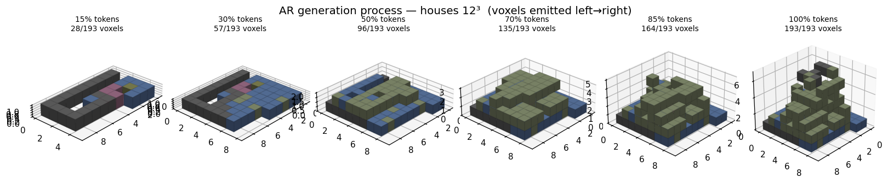

# BlockGen

**Generative models of buildable 3D block structures, and the evaluation that keeps
them honest.**

BlockGen learns to generate new, plausible 3D structures, starting from Minecraft voxel
builds, and measures whether the outputs are novel and whether they are houses a player
could walk into. The representation and the evaluation are medium-agnostic by design so
that the same stack carries to LEGO (`research.md` §E, §I).

## Naming

Two letter schemes are in use and they do not collide once named. A **Track** is a
generator family ([Models](models.md)): A autoregressive tokens, B masked diffusion,
C graph VAE, D LLM baseline, E agentic programs, F pick-and-place. An **Arm** is a
tokenisation story trained through the shared trainer
([Training pipeline](pipeline.md) §4): A sparse raster, B 3D-BPE pieces, C dense grid,
D text lines, E facades. Each page uses one word and says so.

## What's here

- **A corpus layer** (`blockgen/corpus/`): one manifest over 927k builds (world crops
  plus curated caches plus game templates), exact and near dedup, a kinds sidecar, tiers
  with hashed member lists, and tokenised shards in two kinds, `voxels` and `facades`
  ([Data](data.md)).
- **A shared trainer** (`blockgen/train/`): `python -m blockgen.train --config
  configs/train/<name>.yaml`, one step-based loop with a WSD schedule, `init_from` for
  stages, an architecture registry (`blockgen/train/archs.py`), end-of-run sampling and
  benchmark, and one line per run in `outputs/registry.jsonl`
  ([Training pipeline](pipeline.md)).
- **Post-training** (`blockgen/posttrain/`): best-of-N with a verifier (`bon.py`),
  rejection-sampling fine-tuning through derived tiers (`rft.py`), a `select=reward`
  hook, and rewards that refuse BlockScore pillar inputs by construction
  ([Training pipeline](pipeline.md) §7).
- **Generator tracks** over one `Structure` type ([Models](models.md)): the
  autoregressive token transformer (A) with its grammar-aware phase4 PE, prefix
  conditioning (`CondVoxelAR2`) and a Q-Former-lite resampler; masked discrete diffusion
  (B); a graph VAE (C); the LLM baseline on text lines (D); LLM-written build programs
  (E, [Agentic](agentic.md)); pick-and-place growth (F, [Pick-and-place](pick-and-place.md)).
- **The facade track**: six `(depth, id)` face images per build, lifted back into a
  box, with its own oracle ceilings, baselines and models
  ([Representations](representations.md) §6).
- **A validated cross-track benchmark** ([Evaluation suite](benchmark.md)): every metric
  passes a corruption ladder before it ranks anything; realism is reported beside
  novelty; `BlockScore` is the worst pillar; a traversal pillar asks whether a player can
  get in.
- **BlockLab** ([BlockLab](lab.md)): the local app for browsing corpora, labelling, 2AFC
  comparison, and reading a run or the cross-run board with the builds beside the numbers.
- **A LegoACE port** (`libs/MinecraftACE`) with unconditional and multi-view
  image-conditioned runs ([MinecraftACE](minecraftace.md)), and an **auto-labelling
  pipeline** of renders, captions and frozen embeddings ([Labeling](labeling.md)).
- **An operator's map** of every package and model class ([Architecture](architecture.md)),
  the model contract ([Bring your own model](custom-model.md)), the route from an empty
  editor to a board row ([Add a model, end to end](add-a-model.md)), and a generated matrix
  of what is used, unused, planned or stale ([Status matrix](status.md)).

## Start here

[Getting started](getting-started.md) sets up the environment and the data caches.
[Workflow](workflow.md) walks the route everything else assumes: train a model, sample
it to an evaluation arm, score it against controls and baselines, and look at it in
BlockLab. An arm is a cache of structures, so procedural generators, LLM programs and
hand-built sets enter the pipeline on equal terms.

## Headline results

| Finding | Evidence |
|---|---|
| Pretraining on world crops then SFT beats matched scratch on every seed, on likelihood (0.416 vs 0.543 nats) and on the board (340.7 vs 426.9 BlockScore, n=256) | T60, `scripts/m2b_seeds.sh` |
| Render-space realism is structurally blind: deleting every interior is not separable from real on MV-DINO-KID | T25, `real@solidify` |
| `geom_kid` sees interiors, needs no GPU, and is invariant to yaw and material | T25 |
| The standard point-cloud suite (MMD, coverage, 1-NNA under chamfer and IoU) is as blind to interiors as the render tier | T67, `blockgen/eval/bench/pointcloud.py` |
| A player enters 95% of real houses, 2% of LLM-arm builds, 50 to 68% of agentic builds | T63, `blockgen/eval/traversal.py` |
| A facade-only generator's ceiling is the visible shell: `real@facades6` scores 493 where real is 0 | T65, `scripts/facade_oracle.py` |
| Best learned facade arm 1035 (20M joint); D4 augmentation is worth 0.33 nats at 20M; patchwork (990) still leads every learned facade model | T66, T68 |
| Best ranked learned arm on the main board: 3D-BPE `canon_oriented` at 141.82; `dream-caption` 155.83 is the best agentic arm | T64 |
| Adjacency-constrained decoding gives validity 1.0 by construction, quality-neutral | T11 |
| Programs beat per-voxel tokens for scale: a 1,070-block coherent house for $0.008 | T22 |

The dated tables are in the root `results.md`; the plan is `research.md` §I.

/// caption
The AR model generates a house bottom-up: foundation, walls, pitched roof.
///

## The core challenge: variable size

Real builds vary wildly in size. BlockGen always `crop_to_non_air()` first, then handles
size per track: EOS-terminated token streams (A, D), a fixed canonical grid (B),
size-agnostic graphs (C), a `STOP`-terminated attachment stream (F), and for the facade
arm a real bounding box sampled with the faces. Large builds reach the token tracks
through windows (shards) or scale normalisation. See [Representations](representations.md).
