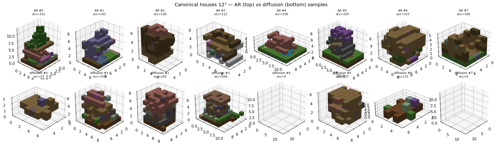
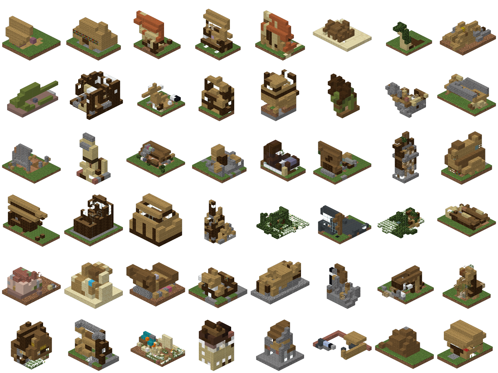

# Models: the tracks

This page uses **Track** for a generator family. The letters here are not the letters of
[Training pipeline](pipeline.md) §4, where **Arm** names a tokenisation story trained
through `blockgen.train` (Arm A sparse raster, B 3D-BPE, C dense grid, D text lines,
E facades). Track A, B, C and D are trained models; Track E writes programs and Track F
grows a build by attachment. All of them produce the same `Structure` and are scored by
the same benchmark ([Evaluation suite](benchmark.md)).

| Track | What generates | Code | Trainer | Best number |
|---|---|---|---|---|
| A | causal transformer over `(X, Y, Z, BLOCK)` tokens | `blockgen/models/voxel_transformer_ar2.py` | `blockgen.train` (`arch: ar2`), legacy `blockgen/training/train_ar_ext.py` | M2b SFT mean BlockScore 340.7, NLL 0.416 (T60); 3D-BPE `canon_oriented` 141.82 on the main board (T64) |
| A, facade arm | the same transformer over `(depth, id)` face images | `blockgen/corpus/facade.py`, `kind: facades` | `blockgen.train` | 1035 at n=399, 20M joint (T68) |
| B | masked discrete diffusion 3D-UNet | `blockgen/models/voxel_diffusion.py` | legacy `train_diffusion.py` | validity 0 raw at 32³ (T11) |
| C | graph latent VAE | `blockgen/models/large_pyg_graph_generator.py` | legacy `train_graph.py` | never memorises, trails A (T10) |
| D | LLM LoRA over one text line per block or piece | `scripts/train_llm_brickgpt.py`, `train_llm_pieces.py`, `train_llm_geobias.py` | its own scripts | `llm_control` 167.92, `llm_bias` 191.88, provisional (T64) |
| E | frontier LLM writes a build program | `blockgen/agentic/` | none (API calls) | `dream-caption` 155.83, provisional (T64) |
| F | picker and placer heads over a growth graph | `blockgen/models/pick_n_place.py` | legacy `train_pick_n_place.py` | KID 0.532 at n=16, off board (T24) |

## Track A: autoregressive token transformer

`VoxelTransformerAR2` (`blockgen/models/voxel_transformer_ar2.py`) is a causal
transformer over the `[BOS, tags, (X, Y, Z, BLOCK)*, EOS]` stream
([Representations](representations.md) §1). Variable size is intrinsic: EOS terminates.
The `(y, z, x)` raster order makes generation a bottom-up build. It is the only
architecture registered in the shared trainer today (`blockgen/train/archs.py`,
`arch: ar2`), with presets 5m (5.5M) and 20m (26.8M) in `blockgen/train/config.py`.

/// caption
Canonical 12³ houses: AR (top) makes consistent houses; diffusion (bottom) is mixed.
///

### Pretraining on world crops (T58 to T60)

The M2b protocol: 20,000 steps on the `anneal` tier (591M tokens), then 16,000 steps of
SFT on `sft-houses32` from that checkpoint, against a scratch arm given the matched 36,000
steps on `sft-houses32`, three seeds, dropout 0 in both, `select: best` on holdout NLL,
scored at n=256. Pretrain then SFT wins every seed: 0.416 against 0.543 nats on holdout
and 340.7 against 426.9 BlockScore. The scratch arm overfits after 8,000 to 10,000 steps;
the pretrained one sits on a plateau. Against the best regularised scratch run tried so far
(T59, dropout 0.1) it is a tie on likelihood, which is the comparison still owed
(`research.md` I.5). Configs: `configs/train/anneal-pretrain-5m.yaml`,
`houses32-sft-5m.yaml`, `houses32-scratch-matched.yaml`; recipe `scripts/m2b_seeds.sh`.

### The quality levers that ship on Track A

- **Adjacency-constrained decoding** (`blockgen/training/constrained_decode.py`): the
  next-voxel logits are masked to the 6-neighbourhood of placed voxels, so validity is 1.0
  by construction and quality is unchanged in raster order (T11). It is a legacy-sampler
  feature; `blockgen/train/sample.py` has no logits-mask hook yet.
- **Grammar-aware phase4 PE** (`pe=phase4`): a `pos % 4` phase embedding (which of X, Y,
  Z, BLOCK) plus a `pos // 4` record-index embedding. Best PE in the T11 ablation; RoPE
  and ALiBi do not win because coordinates travel as tokens, not positions.
- **3D-BPE piece tokens** (`blockgen/tokenizers/cluster_bpe.py`): frequent voxel
  neighbourhoods merged into learned pieces. Anti-memorisation on vehicles (T10) and the
  best ranked learned arm on the main board (`canon_oriented`, 141.82, T64). Pieces are a
  legacy per-run vocabulary, not a shard kind, so these checkpoints cannot be loaded into
  `blockgen.train`.

/// caption
`ar_raster_constrained` samples (real-texture render): single-component, house-gestalt
massing, validity 1.0 by construction.
///

### Conditioning: `CondVoxelAR2` and the resampler

`CondVoxelAR2` (`blockgen/models/voxel_transformer_cond.py`) subclasses AR2 and adds the
LegoACE recipe: frozen DINOv2 or CLIP embeddings through a linear `cond_proj` to prefix
tokens, a learned `null_cond` trained by 10% condition dropout, and classifier-free
guidance in `generate_cond(cfg_scale=...)`. Trainer: `blockgen/training/train_conditioned.py`
([Labeling](labeling.md) builds the renders, captions and embeddings it consumes). At the
16³ regime image conditioning lifts palette fidelity 112% over shuffled conditions
(T16); at native 32³ the same code conditions weakly (T15).

`ResampledCondVoxelAR2` (`blockgen/models/condition_resampler.py`) replaces the pooled
prefix with a Q-Former-lite resampler over the full CLIP text token sequence
(`last_hidden_state`, `cond_dim` 512; SigLIP is only the `--text-encoder siglip` option of
`blockgen/labeling/embed_conditions.py`); trainer
`scripts/train_cond_resampler.py`, run `outputs/cond/text_resampler`, no T-number. The
shared trainer has no conditioning channel in its shards or sampler, so conditioned SFT
is a planned stage ([Training pipeline](pipeline.md) §6).

### The facade arm (T65 to T68)

The same transformer over a 2.5D reading of a build: six `(depth, id)` face images,
tokenised as one sequence per face (`per_face`) or all faces of a build in one sequence
(`joint`), and lifted back into a real bounding box at sampling
([Representations](representations.md) §6, `blockgen/train/sample.py::facade_builds`).

- **The ceiling.** `scripts/facade_oracle.py` reduces real test houses to their visible
  shell: `real@facades4/5/6` keep a median 56%, 65%, 79% of blocks and nothing inside.
  `real@facades6` scores 493 where real is 0 (T65). No facade-only generator can beat it.
- **Baselines.** `blockgen/corpus/facade_baselines.py`: unigram 2208, markov 1335,
  patchwork 990 at n=399 (T66).
- **Models.** Per-face 5M 1205; joint 5M 1128; joint 20M 1035; joint 5M D4 1113; joint 20M
  D4 1082, all at n=399 (T66, T68). D4 augmentation of the shard is worth 0.33 nats at 20M
  (0.806 to 0.479 holdout NLL). Patchwork still leads every learned facade model on
  BlockScore; the remaining failures are relief noise inside faces and empty interiors
  (T68), which is why the first post-training rewards are face statistics
  (`blockgen/posttrain/rewards.py::FaceSolidity`). Configs: `configs/train/houses32-facades*.yaml`.

## Track B: masked discrete diffusion (3D-UNet)

`blockgen/models/voxel_diffusion.py`, trainer `blockgen/training/train_diffusion.py`.
A compact 3D-UNet over the `grid³` class volume trained MaskGIT/D3PM-style: mask a
fraction of voxels, predict them with cross-entropy, air down-weighted. Four samplers on
one net: `sample_grids` (MaskGIT confidence order), `sample_grids_flow` (discrete flow
matching), `sample_grids_remask` (broken, T11), `sample_grids_stratified`. Each sampler
needs its own `air_bias`; a sharp net commits air first under MaskGIT and under-fills. At
32³ diffusion stayed uncalibrated (validity 0 raw, T11). It is Arm C of the pipeline and
has no `blockgen.train` registration: the loop's collate and loss are AR-specific.

## Track C: graph latent VAE

`blockgen/models/large_pyg_graph_generator.py`, trainer `blockgen/training/train_graph.py`.
TransformerConv encoder over the block-and-port graph, Gaussian latent, GRU token decoder
with a `size_head`. Size-agnostic and the closest form to LEGO stud graphs. Never
memorises and trails AR on every battery (T10).

## Track D: the LLM baseline

A pretrained LLM (Qwen2.5) fine-tuned with LoRA on one text line per block (BrickGPT
format, `scripts/train_llm_brickgpt.py`) or per 3D-BPE piece (`train_llm_pieces.py`).
`train_llm_geobias.py` adds a learned additive attention bias indexed by the relative 3D
offset between the pieces two tokens refer to, zero-initialised so the `--bias` arm starts
identical to the control. On the main board `llm_control` scores 167.92 and `llm_bias`
191.88, both provisional because their `train_split` is `trackd` (T64); a player enters 2%
of their builds (T63). This is Arm D in the pipeline's table and is the reviewer-expected
baseline.

## Track E: agentic build programs

[Agentic generation](agentic.md). A frontier LLM emits a build program in a
WorldEdit-style command language that is executed onto a canvas; no training, any canvas
size, free text or image conditioning. The methods suite ([Agentic methods suite](agentic-suite.md))
adds dream loops and captions; `dream-caption` is the best agentic arm at 155.83 (T64),
provisional because `train_split` is `none`.

## Track F: pick-and-place growth

`blockgen/models/pick_n_place.py`, trainer `blockgen/training/train_pick_n_place.py`,
full page [Pick-and-place](pick-and-place.md). Two heads over one causal graph encoder:

$$ \text{Picker}: G \to P(V) \qquad \text{Placer}: G \times V \to P(E) $$

A build grows one voxel at a time by naming an open face of an already-placed voxel, so
connectivity is guaranteed by the representation; geometry enters as a relative-offset
attention bias. Validity 1.0 by construction, round-trip IoU 1.000, placer at 139 times its
legal-face chance baseline (T24). The dense legality tensor caps `max_nodes` at 384
against a corpus median of 1,069 blocks, so its KID (0.532 at n=16) is confounded with
size and it stays off the board.

## Other model code

| Class | File | Status |
|---|---|---|
| `VoxelTransformerAR` (v1, learned PE) | `blockgen/models/voxel_transformer_ar.py` | superseded by AR2 `pe=learned` |
| `GeoAttentionBias` | `blockgen/models/geo_attention_bias.py` | null to mildly negative (T29) |
| `FactoredPieceEmbedding` | `blockgen/models/factored_embedding.py` | unused since T20 |
| `SemanticTokenEmbedding` (idea #7) | `blockgen/models/semantic_embedding.py` | tested negative |
| `VoxelPortGNN` | `blockgen/models/voxel_port_gnn.py` | starter, unused |
| MinecraftACE GPT-2 and MV LLaMA | `libs/MinecraftACE` | separate stack ([MinecraftACE](minecraftace.md)) |

## Evaluation (`blockgen/eval/novelty.py`)

`blockgen/eval/novelty.py` is the shared novelty report: `mean_nn_iou` (low means novel),
`duplicate_rate` (NN-IoU at least 0.95), `diversity`, `validity_rate`,
`mean_block_agreement`, with comparison grids of each sample beside its nearest training
neighbours. `blockgen/eval/bench/` is the benchmark every track is ranked by:
BlockScore, the calibration controls, the ladder, the protocol, the traversal pillar
([Evaluation suite](benchmark.md)).
