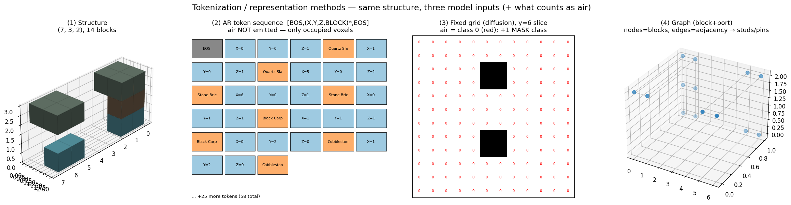
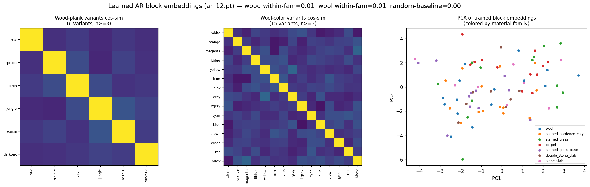

# Representations & tokenization

All three tracks read from one `Structure` (a cropped XYZ block volume) and one
`BlockVocab`, via `blockgen/utils/serialize.py`. There are **four representations** in use, and
a fifth proposed.



/// caption
The same structure as (1) a build, (2) an AR token stream, (3) a fixed grid, (4) a graph.
///

## 1. AR token sequence (Track A, and the graph decoder)

```
[BOS, X, Y, Z, BLOCK, X, Y, Z, BLOCK, ..., EOS]
```

Occupied voxels are emitted in `(y, z, x)` raster order — so generation proceeds
**bottom-up, layer by layer**. Variable size is handled entirely by the `EOS`
terminator; no fixed grid, no size prior. The unified vocab is:

```
[PAD, BOS, EOS]  +  max_dim coordinate tokens (shared x/y/z)  +  block-class tokens
```

Every emitted id is `< vocab.vocab_size` by construction (asserted) — this removed a CUDA
device-side assert during sampling.

## 2. Fixed canonical grid (Track B diffusion + all novelty eval)

Crop, then center-pad into a `grid³` array of class indices. Translation-tolerant, so it
doubles as the common representation for nearest-neighbor search.

## 3. Graph (Track C, and the transfer target)

The block+port PyG graph: nodes are blocks, edges are adjacency / ports. This maps
directly onto **LEGO stud connectivity** and **electronics netlists** — the reason Track C
is the most transferable (see `research.md` §I at the repo root).

## 4. Growth sequence (Track F, pick-and-place)

`blockgen/utils/growth_order.py`. A build as an ordered list of **attachments**:

```
node 0 = seed;   node t = (piece, parent index, which of 6 faces)
```

Coordinates are *derived*, never emitted — `growth_to_structure` replays the
stream by walking `parent`/`direction` from the seed and never reads the stored
coords, which is what makes the round-trip a real test (measured IoU exactly
**1.000**). Two properties follow directly from the form:

- the build is **connected by construction** — every node is 6-adjacent to an
  earlier one, so there is no disconnected-component failure mode to fix later;
- the stream is `n_blocks` long, versus `≈ 4·n_blocks` for the AR token stream.

The cost is that *where* becomes a decision the model has to make, over the open
faces of the partial build (a median of **1,980** of them by the end of a real
house). See [Pick-and-place](pick-and-place.md).

## 5. (Proposed) delta-coordinate AR

Emit each voxel's coordinates *relative to the previous voxel* to shorten the AR stream
and bias toward locality — the planned way to let AR reach 16–24³ without the fidelity
loss of aggressive downsampling.

---

## 6. Facades (2.5D, the generation-first-in-2D track)

Six face images per build, one per axis and end: each pixel of a face is the
depth to the first block along that axis and the block's id and data, `-1`
where see-through (`blockgen/corpus/facade.py`). The four sides are the
facades, `+y` the roof plan, `-y` the underside. `lift` writes any set of faces
back into a canvas; `shell` (project then lift) is the visible shell of a build
and the ceiling of a facade-only generator (results.md T65). A facade is a 2D
grid of `(depth, id)` tokens, which is what a sequence model lays out reliably.

**Switching between representations.** `blockgen/corpus/reps.py` is the one
place that knows the names: a `Representation` is `encode`, `decode` and
`picture`, and `voxels` and `facades` are registered. BlockLab's drawer, a
tokenizer kind or a figure script asks `reps.get(name)` and uses the verbs, so
a new representation is one entry there.

**As tokens.** `CorpusTokenizer.default(kind="facades")` adds two tag groups, `face`
(the six faces) and `cell` (`empty`), to the shared vocabulary; a face is
`[BOS, src, q, size, win, face, U, V, cell*, EOS]` with `U`, `V` and depths as
coordinate tokens and a filled cell as `(depth, block)`. The voxel tokenizer's hash
is untouched. Sampling prompts the model with the face and its size, so the four
walls and the roof of one build are generated into one real bounding box.

## Does air count as a token?

It depends on the representation — this is a real modeling choice:

| Representation | Is air a token/class? |
|---|---|
| **AR token sequence** | **No.** Only occupied voxels are emitted; air is the *absence* of a token. This keeps sequences short but means the model never explicitly "places air". |
| **Fixed grid (diffusion)** | **Yes.** Air is **class 0**, and there is an extra **MASK** class (the absorbing state). ~99% of grid cells are air, so the loss **down-weights the air class** (`air_weight ≈ 0.05`) and sampling uses a calibrated `air_bias` to control density. |
| **Graph** | **No.** Only blocks are nodes. |
| **Growth sequence** | **No** — and there is no `NO_BLOCK` token either. A node is always a placed voxel; air is any cell never chosen. The reserved ids are `STOP` (the build is finished) and `PAD`. "Leave this face empty" is the default, not a decision, so *all* termination pressure rests on the single `STOP` token — see [pick-and-place §3](pick-and-place.md#3-are-the-elements-tokenized-yes-and-there-is-no-air-token). |

## Do we have embeddings for tokens / voxels?

**Learned token embeddings: yes.** Each model has a trainable `nn.Embedding`
(AR `token_embedding`, diffusion class `embed`, graph block embedding). They are learned
from scratch per run — not pretrained, not structured.

**Structured "birch ≈ oak" voxel embeddings: no — and we measured that the flat ones do
not develop that structure.** Extracting the trained AR block embeddings and comparing
material variants:



/// caption
Wood-plank and wool-color variants are **near-orthogonal** (bright diagonal, dark
off-diagonal); within-family cosine similarity (≈0.006–0.008) sits at the random baseline
(≈0.002), and the PCA shows families fully intermixed.
///

So oak / spruce / birch (and the 16 wool colors) are treated as **independent atoms** —
the model does *not* know birch is like oak. This is the empirical motivation for
**factored embeddings** `E_family[id] + E_variant[data]`, so that all woods (and all
wools) share statistics and rare variants generalize. T20 tested it as `FactoredPieceEmbedding`
(off by default; [Status matrix](status.md) section 5); the plan is `research.md` §I at the repo root.
